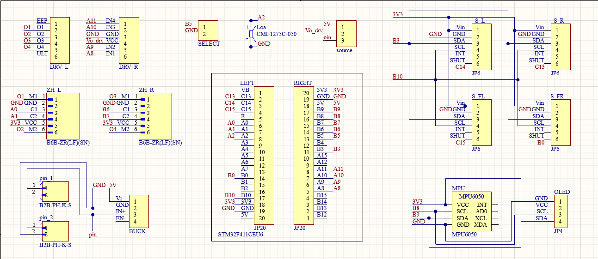
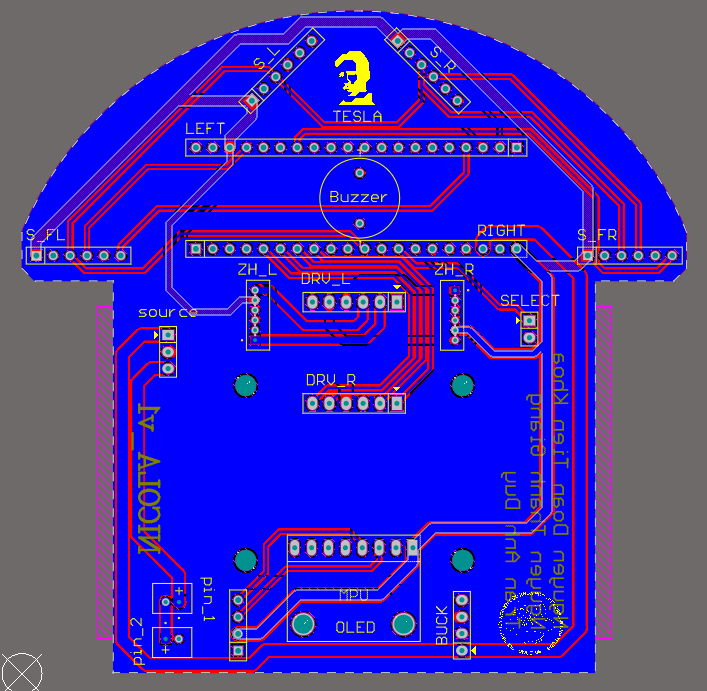
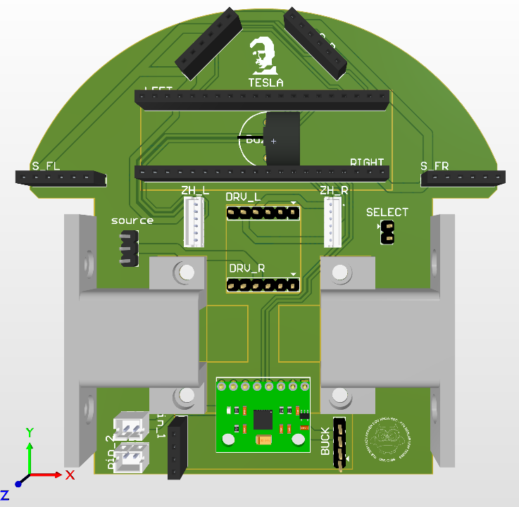
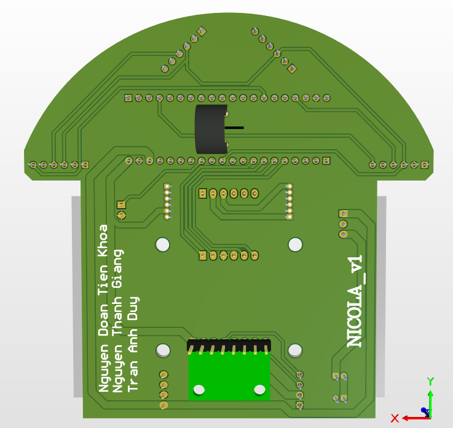
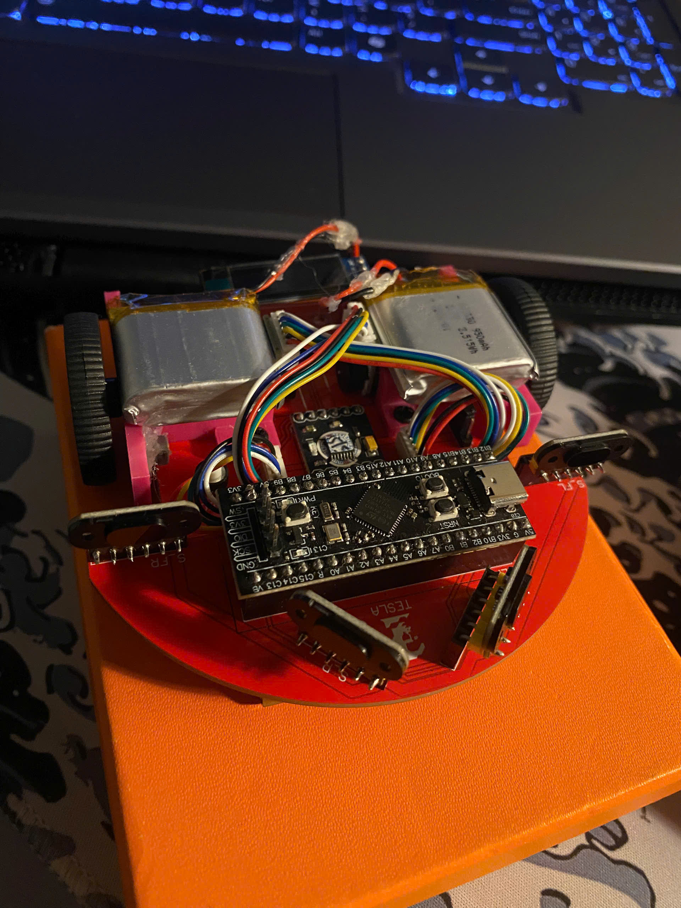
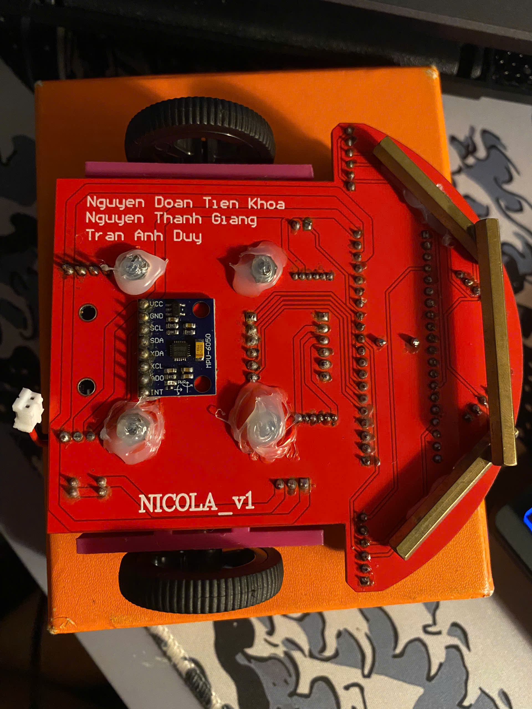

# PCB_ver1 – NICOLA_v1

Mạch in riêng cho robot Micromouse, thiết kế bằng **Altium Designer**. Bo mạch đóng vai trò "khung xe": gắn vi điều khiển, driver, cảm biến và động cơ lên cùng một tấm PCB, thay cho dây cắm rời ở các bản TESLA.

📦 **File in mạch (Gerber/Drill):** [`gerber/NICOLA_v1.rar`](gerber/NICOLA_v1.rar) – giải nén và gửi lên nhà sản xuất PCB (JLCPCB, PCBWay, …).

## 1. Sơ đồ nguyên lý (Schematic)

### Các khối chính
| Khối | Linh kiện | Kết nối |
|---|---|---|
| Vi điều khiển | **STM32F411CEU6** (Black Pill, header `LEFT` / `RIGHT` 20 chân) | Cắm trực tiếp lên PCB |
| Driver động cơ | 2 × DRV8833 (`DRV_L`, `DRV_R`) | `IN1–IN4` ↔ `A8, A9, A10, A11`; ngõ ra `O1–O4` tới động cơ |
| Động cơ + encoder | 2 × đầu nối 6 chân `ZH_L`, `ZH_R` (B6B-ZR) | Encoder trái `A0, A1`; encoder phải `B6, B7` |
| Cảm biến khoảng cách | 4 × đầu cắm 6 chân `S_L`, `S_R`, `S_FL`, `S_FR` (Vin, GND, SDA, SCL, INT, SHUT) | I2C chung `B3` / `B10`; chân SHUT: `C14`, `C13`, `C15`, `B0` |
| Con quay | MPU6050 | I2C `B8` (SCL), `B9` (SDA) |
| Màn hình | OLED 4 chân (`JP4`) | Chung bus I2C với MPU6050 |
| Loa | Buzzer CMI-1275C-050 | `A2` |
| Nút nhấn | `SELECT` | `B5` |
| Nguồn | 2 × cổng pin B2B-PH-K-S (`pin_1`, `pin_2`), mạch hạ áp `BUCK` (ra 5V), jumper `source` chọn nguồn cho driver (`Vo_drv`) | |

## 2. Thiết kế PCB

### Layout 2 lớp

### Mô phỏng 3D

| Mặt trên | Mặt dưới |
|---|---|
|  |  |

- Bo 2 lớp, phần đầu bo dạng bán nguyệt để xe xoay trong ô mê cung không chạm tường.
- 2 cảm biến chéo phía trước (`S_L`, `S_R`) đặt nghiêng 45°, 2 cảm biến hông (`S_FL`, `S_FR`) ở hai bên.
- Hai động cơ đặt giữa thân xe; MPU6050 và OLED ở phía sau; buzzer nằm giữa hai hàng header của STM32.

## 3. Hình ảnh thực tế

| Mặt trên | Mặt dưới |
|---|---|
|  |  |
