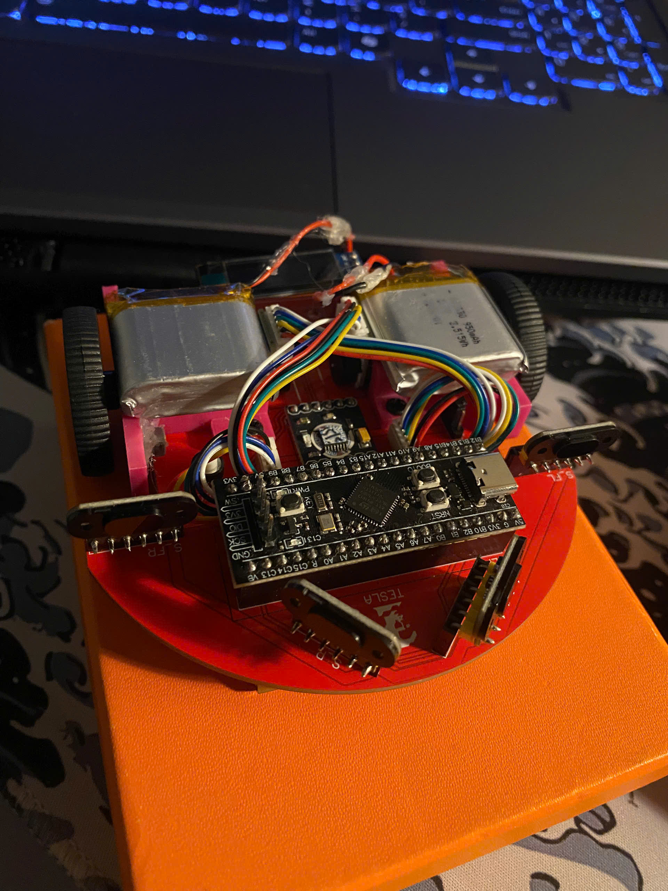
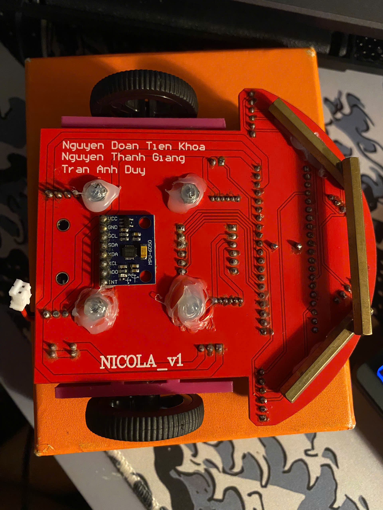

# 🐭 Micromouse – Robot giải mê cung tự hành

Đồ án thiết kế và chế tạo robot **Micromouse** (robot tự tìm đường trong mê cung) qua 3 phiên bản:

| Phiên bản | Nội dung chính | Trạng thái | Thư mục |
|---|---|---|---|
| **TESLA_ver1** | Cảm biến siêu âm + MPU6050, thuật toán bám tường trái (Left-Hand Rule) | ✅ Hoàn thiện | [`TESLA_ver1/`](TESLA_ver1/) |
| **TESLA_ver2** | Cảm biến ToF VL53L0X + encoder + MPU6050, thuật toán **Flood Fill**, menu OLED, lưu Flash | ✅ Hoàn thiện | [`TESLA_ver2/`](TESLA_ver2/) |
| **PCB_ver1 (NICOLA_v1)** | Mạch in riêng cho robot (Altium Designer) | 🛠️ Phần cứng | [`PCB_ver1/`](PCB_ver1/) |

📷 Hình ảnh xe thực tế: [mục Hình ảnh xe](#5--hình-ảnh-xe)

---

## 1. Giới thiệu

Micromouse là cuộc thi robot trong đó một robot nhỏ phải **tự khám phá một mê cung chưa biết**, tìm đường tới đích và sau đó chạy lại quãng đường ngắn nhất trong thời gian nhanh nhất. Robot phải tự động hoàn toàn: không có điều khiển từ xa, mọi quyết định đều dựa trên cảm biến và thuật toán trên vi điều khiển.

### Mục tiêu đồ án
1. Xây dựng robot có khả năng **đi thẳng ổn định** giữa hai bức tường (PID kết hợp con quay hồi chuyển và khoảng cách tường).
2. **Rẽ chính xác 90° / 180°** bằng cảm biến MPU6050.
3. Phát hiện tường và **ra quyết định** tại mỗi ô của mê cung.
4. Nâng cấp từ thuật toán bám tường đơn giản lên **Flood Fill** để tìm đường ngắn nhất.
5. Thiết kế **PCB riêng** để thay thế dây cắm rời, giúp robot gọn, nhẹ và tin cậy hơn.

## 2. Tổng quan hệ thống

```
          ┌──────────────┐   I2C   ┌───────────────┐
          │   MPU6050    │◄───────►│               │◄──── Nút nhấn / Menu
          └──────────────┘         │               │
          ┌──────────────┐   I2C   │  STM32 (Black │───► OLED SSD1306 128x64
          │ Cảm biến     │◄───────►│  Pill) –      │
          │ khoảng cách  │         │  Arduino core │
          └──────────────┘         │               │
          ┌──────────────┐  PWM    │               │  Interrupt  ┌──────────┐
          │ Driver động  │◄────────│               │◄────────────│ Encoder  │
          │ cơ (2 kênh)  │         └───────────────┘             └──────────┘
          └──────┬───────┘
                 ▼
          2 động cơ DC giảm tốc (N20)
```

- **Vi điều khiển:** STM32, lập trình bằng Arduino IDE với [STM32duino core](https://github.com/stm32duino/Arduino_Core_STM32).
- **Cảm biến góc:** MPU6050 (con quay hồi chuyển trục Z) để giữ hướng và quay góc.
- **Cảm biến khoảng cách:** siêu âm HC-SR04 (ver1) → laser ToF VL53L0X (ver2).
- **Hiển thị:** OLED SSD1306 0.96" (I2C, địa chỉ `0x3C`).

## 3. Các phiên bản

### 🔹 TESLA_ver1 – Bám tường trái
- Code cuối: [`TESLA_ver1/banket/banket.ino`](TESLA_ver1/banket/banket.ino)
- 3 cảm biến siêu âm (trước – trái – phải) có **lọc trung vị 3 mẫu**.
- PID giữ hướng theo MPU6050 + bù khoảng cách tường.
- Ưu tiên: **Rẽ trái → Đi thẳng → Rẽ phải → Quay đầu**, mỗi quyết định đều được **xác nhận lại 5 lần** để chống nhiễu.
- 👉 Chi tiết: [TESLA_ver1/README.md](TESLA_ver1/README.md)

### 🔹 TESLA_ver2 – Flood Fill
- Code cuối: [`TESLA_ver2/test2/test2.ino`](TESLA_ver2/test2/test2.ino)
- 3 cảm biến laser **VL53L0X** (đổi địa chỉ I2C bằng chân XSHUT), **encoder** hai bánh.
- Bộ điều khiển kết hợp 3 thành phần: **Yaw (MPU) + Tường (PD) + Encoder**.
- Thuật toán **Flood Fill** trên bản đồ 32×32 có tọa độ âm, 2 giai đoạn: **khám phá** → **chạy nhanh** (gộp nhiều ô thẳng).
- **Menu OLED** điều khiển bằng cách xoay bánh xe (encoder) + 1 nút: chọn tọa độ đích, tốc độ, xung/ô, hệ số PID; tất cả **lưu vào Flash (EEPROM giả lập)**.
- 👉 Chi tiết: [TESLA_ver2/README.md](TESLA_ver2/README.md)

### 🔹 PCB_ver1 – NICOLA_v1
- Sơ đồ nguyên lý & PCB 2 lớp vẽ bằng **Altium Designer**, dùng STM32F411CEU6, 2 × DRV8833, 4 cảm biến khoảng cách, MPU6050, OLED, buzzer.
- File in mạch: [`PCB_ver1/gerber/NICOLA_v1.rar`](PCB_ver1/gerber/NICOLA_v1.rar)
- 👉 Chi tiết: [PCB_ver1/README.md](PCB_ver1/README.md)

## 4. So sánh các phiên bản

| Tiêu chí | TESLA_ver1 | TESLA_ver2 |
|---|---|---|
| Cảm biến khoảng cách | 3 × HC-SR04 (siêu âm) | 3 × VL53L0X (laser ToF) |
| Đo quãng đường | Theo thời gian | Encoder (xung/ô) |
| Giữ hướng | PID theo MPU6050 + bù tường | PD Yaw + PD Tường + Encoder |
| Thuật toán | Bám tường trái | Flood Fill (khám phá + chạy nhanh) |
| Chọn đích | Không | Có (menu, tọa độ −15…15) |
| Cấu hình | Sửa code | Menu OLED, lưu Flash |
| Tìm đường ngắn nhất | ❌ | ✅ |

## 5. 📷 Hình ảnh xe

| Mặt trên | Mặt dưới (NICOLA_v1) |
|---|---|
|  |  |

## 6. Cấu trúc repo

```
Micromouse/
├── README.md                  ← Tổng quan đồ án (file này)
├── TESLA_ver1/
│   ├── README.md
│   └── banket/banket.ino      ← Code cuối ver1
├── TESLA_ver2/
│   ├── README.md
│   └── test2/test2.ino        ← Code cuối ver2
├── PCB_ver1/
│   ├── README.md
│   ├── schematic/schematic.png
│   ├── pcb/                   ← layout + 3D mặt trên/dưới
│   ├── gerber/NICOLA_v1.rar   ← File gửi đi in PCB
│   └── images/                ← Ảnh xe thực tế
```

## 7. Hướng dẫn nạp code

1. Cài **Arduino IDE** và thêm board STM32: *File → Preferences → Additional Boards Manager URLs*:
   `https://github.com/stm32duino/BoardManagerFiles/raw/main/package_stmicroelectronics_index.json`
2. *Tools → Board → STM32 MCU based boards* → chọn đúng dòng chip của board.
3. Cài thư viện (Library Manager):
   - `Adafruit SSD1306`, `Adafruit GFX Library`
   - ver1: `MPU6050_light`
   - ver2: `Adafruit MPU6050`, `Adafruit Unified Sensor`, `Adafruit_VL53L0X`
4. Mở file `.ino` của phiên bản cần nạp và Upload (STLink hoặc DFU qua USB).

## 8. Kết luận & hướng phát triển

- Ver1 chứng minh được khả năng đi thẳng, rẽ góc chính xác bằng MPU6050 và giải mê cung bằng bám tường.
- Ver2 nâng cấp lên cảm biến laser, encoder và Flood Fill → tìm được **đường ngắn nhất** và có giao diện cấu hình tiện lợi.
- PCB NICOLA_v1 gom toàn bộ phần cứng lên một bo mạch, giảm dây nối và trọng lượng.

**Hướng phát triển:** chạy chéo (diagonal), điều khiển tốc độ theo profile gia tốc (trapezoid), PCB ver2 tích hợp vi điều khiển trực tiếp lên bo, tối ưu chạy nhanh với tốc độ cao hơn.

## 👥 Thành viên
- Nguyễn Đoàn Tiến Khoa
- Nguyễn Thành Giang
- Trần Anh Duy
